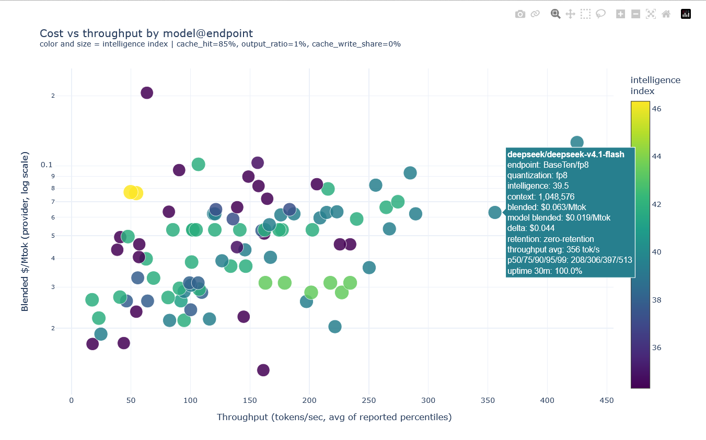

# price-frontier

Cache-aware blended $/Mtok pricing for OpenRouter models and providers.

OpenRouter publishes a `prompt` price per model, but that number rarely
describes what you actually pay. A cache hit costs a fraction of a fresh token,
output tokens cost more than input, and the same model is often cheaper at one
provider than another. `price-frontier` collapses all of that into one
comparable number, at the model level and per provider, then shows the
result as a table, JSON, or an interactive cost-versus-throughput plot.



*Blended $/Mtok against throughput for zero-retention endpoints, generated
with `price-frontier --min-intelligence 34 --descending --plot plot.html
--exclude batch --retention zdr`. Hovering a point in the interactive HTML
names the model@endpoint with the full price and throughput breakdown.*

## Why blended pricing

The naive reading of a price card assumes every input token is fresh and that
input and output cost the same. Both are usually wrong for an agent workload,
so the blended price is parameterized:

```
blended = hit * cache_read
        + (1 - hit) * [ write_share * cache_write + (1 - write_share) * prompt ]
        + output_ratio * completion
```

Defaults reflect a cached agent loop: `--cache-hit-rate 0.85`,
`--output-ratio 0.01`, `--cache-write-share 0.0`. Raise `--output-ratio` for
chat or summarization; raise `--cache-write-share` for a workload that writes a
large cache before reading it. When a provider does not publish
`input_cache_read`, the prompt price is substituted and the row is marked `~`.

## Install

```bash
git clone https://github.com/yousefmrashad/price-frontier
cd price-frontier
uv sync
```

Or run it directly:

```bash
uv run price_frontier.py --help
```

Requires Python 3.13+.

## Usage

The cheapest models by blended price:

```bash
price-frontier
```

Filter and sort by intelligence index instead:

```bash
price-frontier --min-intelligence 30 --sort intelligence --limit 25
```

Compare providers for the top models. `DELTA` is `provider_blended -
model_blended`, so a negative value means that provider undercuts the model's
own headline price:

```bash
price-frontier --limit 6 --provider-sort delta
```

Write an interactive plot and open it in a browser. Hovering a point names the
model and provider, with the full price and throughput breakdown:

```bash
price-frontier --limit 30 --plot frontier.html --provider-sort delta
```

Throughput figures come from OpenRouter's endpoint stats, which require an API
key. Set one for the throughput columns and the plot:

```bash
export OPENROUTER_API_KEY=sk-or-...
```

Machine-readable output:

```bash
price-frontier --limit 20 --json
```

## Reading the output

The model table lists each candidate with its intelligence index, context
length, and the blended price alongside the raw `prompt`, `completion`, and
`cache_read` rates it was derived from, so the blend can be checked by hand.

The provider table expands the top models across every endpoint serving them.
Each row is one model@endpoint pair labeled `Provider/qualifier` (for example
`OpenAI/flex` or `BaseTen/fp4`), because the same provider often serves the
same model at different prices and speeds. The same model can appear several
times: `:batch` variants often cost half and serve a small fraction of the
throughput, and Azure mirrors OpenAI at the same price.

| Column | Meaning |
| --- | --- |
| `ENDPOINT` | `Provider/qualifier` endpoint label derived from the provider tag |
| `MODEL_B` / `PROV_B` | Blended $/Mtok at the model level / at this endpoint |
| `DELTA` | `PROV_B - MODEL_B`; negative means the endpoint is cheaper |
| `CR?` | `~` marks an endpoint with no `input_cache_read` price |
| `ZDR` | Zero data retention: `yes`, `no`, or `?` when unreachable |
| `TPS_AVG` | Mean of the reported throughput percentiles |
| `INTL` | Artificial Analysis intelligence index |

Filter endpoints by data retention with `--retention zdr` (zero-retention only)
or `--retention non-zdr`. The plot shows one point per model@endpoint row, and
hovering a point names the endpoint.

## Options

| Option | Default | Purpose |
| --- | --- | --- |
| `--cache-hit-rate` | `0.85` | Fraction of input tokens served from cache |
| `--output-ratio` | `0.01` | Output tokens per input token |
| `--cache-write-share` | `0.0` | Fraction of uncached input billed as cache writes |
| `--min-intelligence` | none | Drop models below this intelligence index |
| `--with-intelligence-only` | off | Require an intelligence index |
| `--max-blended` | none | Cap the blended $/Mtok |
| `--min-context` | `0` | Minimum context length |
| `--include` / `--exclude` | none | Case-insensitive regex on model id or name |
| `--limit` | `10` | Models to expand per provider |
| `--sort` | `blended` | `blended`, `intelligence`, `prompt`, `context` |
| `--descending` | off | Reverse the sort order |
| `--no-providers` | off | Skip the per-provider join |
| `--provider-limit` | `0` | Cap provider rows per model (`0` = no cap) |
| `--provider-sort` | `provider` | `provider`, `delta`, `model`, `name` (endpoint label) |
| `--retention` | `all` | `all`, `zdr`, or `non-zdr` endpoint data-retention filter |
| `--provider-workers` | `6` | Parallel endpoint requests |
| `--tps` | `avg` | `avg` or `percentiles` for the throughput column |
| `--plot PATH` | none | Write an interactive HTML scatter |
| `--json` | off | Emit JSON instead of a table |
| `--api-key` | `$OPENROUTER_API_KEY` | OpenRouter key; needed for throughput |
| `--api-base` / `--url` | OpenRouter | Override the API endpoints |
| `--timeout` | `30.0` | Per-request timeout in seconds |

## Development

```bash
uv sync --extra dev
uv run pytest        # 70+ tests, no network
uv run ruff check .
uv run ruff format .
```

The test suite covers the pure functions: the blend arithmetic, percentile
parsing across the several shapes OpenRouter returns, and intelligence-index
discovery at arbitrary nesting depth.

## Notes

Prices and throughputs are read live from the OpenRouter API and change
constantly. Nothing here is cached, so two runs a minute apart can disagree.
Provider pricing varies by plan and region; a blended number computed from list
prices will not match an invoice.

`--api-base` and `--url` are plain HTTP overrides, so the tool is not bound to
OpenRouter, but nothing outside the OpenRouter response shape is tested.

## License

GPL-3.0. See [LICENSE](LICENSE).